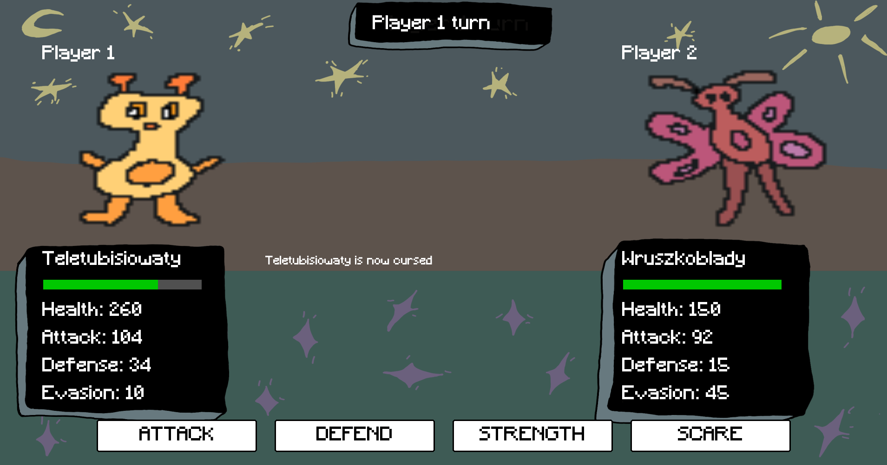

# Turn-Based Creatures Battle Game
A two player, turn-based battle game. Players choose their creatures,
and fight against each other.




## Features
- Creature selection for two local players
- Turn-based combat with attack, defense, healing, and over time status effects
- Creatures are loaded from a JSON file, allowing easy modifications or additions
- Battle log saved during gameplay

## Requirements

- Python
- Pygame

## Run

Install pygame and run the game from the project directory:

```bash
pip install pygame
python main.py
```

## Authors
- Jakub Mituła
- Anna Krol
- Lam Truong Nguyen
- Szymon Duma


